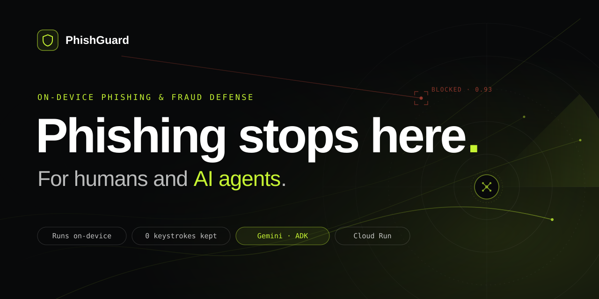
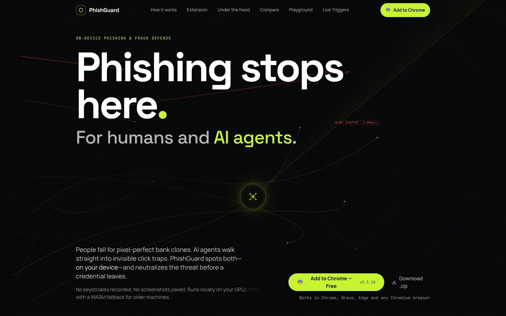
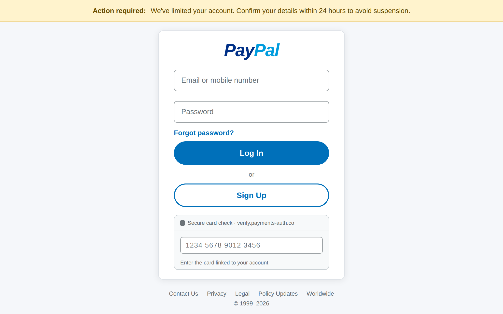
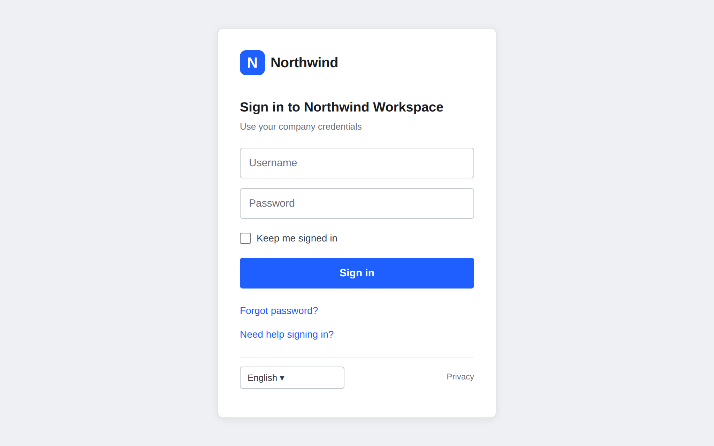
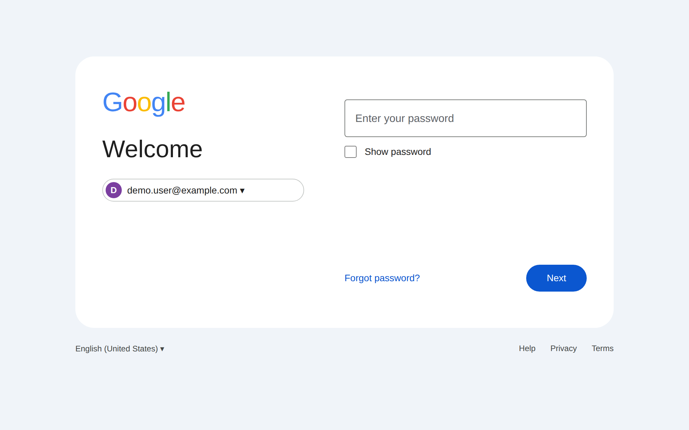
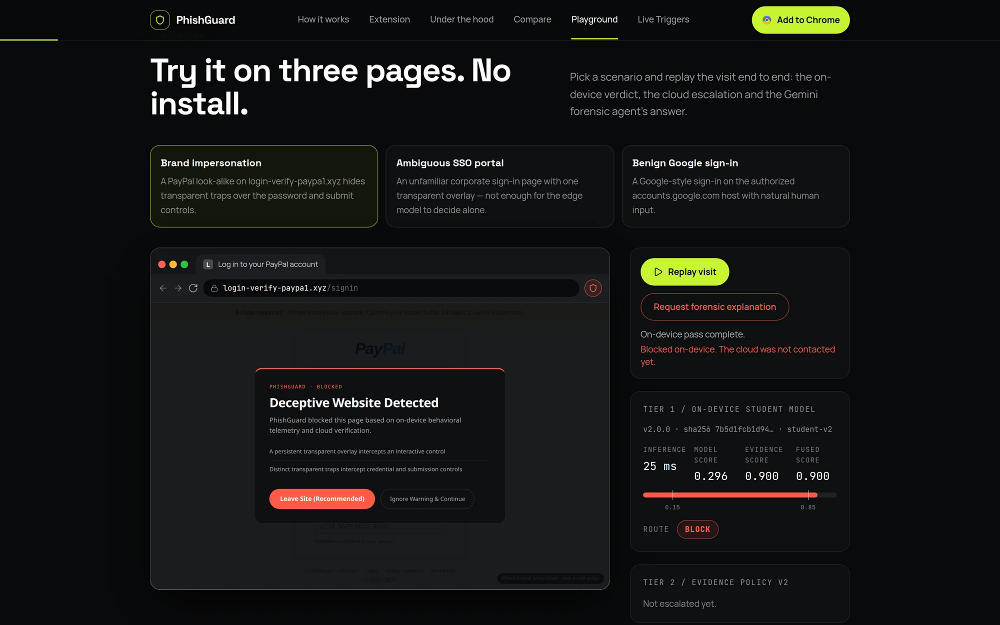
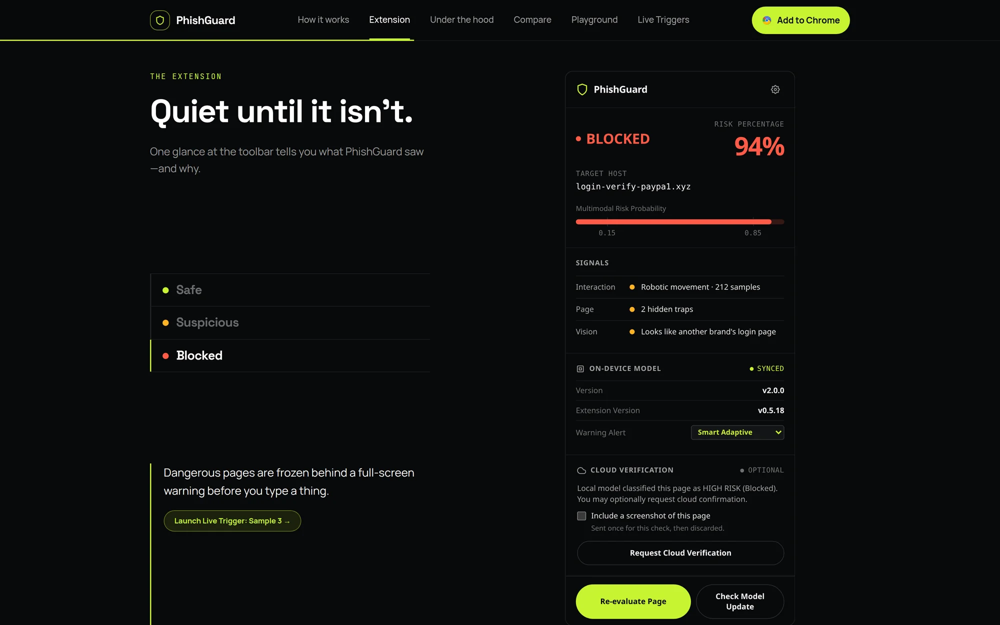
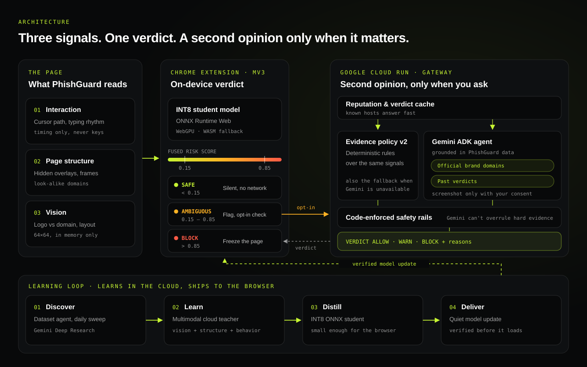

<p align="center">
  
</p>

<p align="center">
  <strong>On-device phishing and fraud defense for people, banks and the AI agents that browse for them.</strong>
</p>

<p align="center">
  
  
  
  
  
</p>

---

## Why

A phishing page takes minutes to build. A blocklist takes days to catch it. An AI agent won't hesitate at all.

PhishGuard doesn't wait for a list. It reads the page itself, on your device, and stops the threat before a credential leaves.



## Try it

Run the stack locally (see [Run locally](#run-locally)) and open `http://localhost:8010/playground` to replay three visits end to end.

| Brand impersonation | Ambiguous SSO portal | Benign sign-in |
| :---: | :---: | :---: |
|  |  |  |
| **Blocked** on-device | **Flagged**, then a Gemini second opinion | **Silent**, no network call |



## How it works

**Three signals. One verdict. On-device.**

- **Interaction:** cursor path and typing rhythm. Timing only, never the keys.
- **Page structure:** hidden overlays, cross-origin frames and look-alike domains.
- **Vision:** does the logo belong to the domain you're on? A small in-memory glance, never saved.

| Score | Verdict | What happens |
| :--- | :--- | :--- |
| `< 0.15` | **Safe** | Nothing. No pop-ups, no network. |
| `0.15 – 0.85` | **Suspicious** | Flagged in the toolbar. Ask Gemini for a second opinion if you want one. |
| `> 0.85` | **Blocked** | The page freezes before you type a thing. |



## Built on Google AI

| | |
| :--- | :--- |
| **Gemini + ADK** | A forensic agent that checks borderline pages against official brand domains and past verdicts. Code-enforced safety rails stop it from overruling hard evidence. |
| **Gemini Deep Research** | A daily dataset agent that finds new phishing pages for retraining. |
| **Cloud Run** | Hosts the gateway, the landing page and the playground. |
| **Cloud Build · Secret Manager · Cloud SQL** | Per-branch deploys, managed secrets and verdict history. |

## Architecture



New tactics are learned in the cloud. A tiny distilled model ships to the browser and is verified before it loads.

## Privacy

- **Zero keystrokes recorded.** Only timing is measured, and the schemas reject anything else.
- **Local by default.** Nothing leaves the device unless you ask for a cloud check.
- **Works offline.** The model ships inside the extension.

## Install

1. Download `phishguard-extension.zip` from your running gateway (`http://localhost:8010/download/phishguard-extension.zip`) and unzip it.
2. Open `chrome://extensions` and turn on **Developer mode**.
3. Click **Load unpacked** and pick the folder.

Works in Chrome, Brave, Edge and Opera.

## Run locally

```bash
./scripts/bootstrap.sh
pnpm compose:local      # http://localhost:8010
```

For more, see [docs/DEVELOPMENT.md](docs/DEVELOPMENT.md).

## License

MIT. See [LICENSE](LICENSE).
